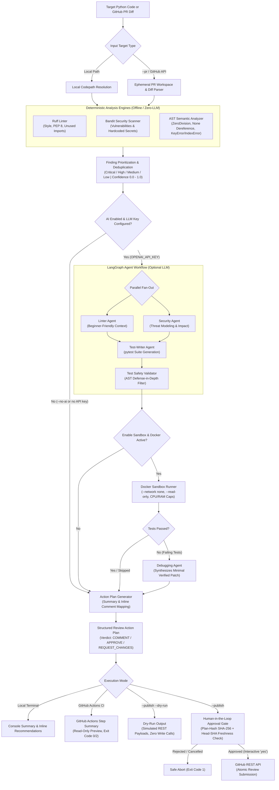

# Multi-Agent Code Review & Debugging Pipeline

> **Autonomous Multi-Agent Static Analysis, Semantic Hazard Detection, Sandboxed Test Execution, and Verified Patch Synthesis for Python.**

The **Multi-Agent Code Review & Debugging Pipeline** is an end-to-end code analysis and repair system built with **LangGraph**, **Ruff**, **Bandit**, **Python AST Semantic Analysis**, **Docker**, and the **GitHub REST API**.

The system features a **dual-mode architecture**:
1. **Deterministic Mode (Default & CI)**: Operates completely offline without requiring LLM credentials or network calls. Combines Ruff (style/linting), Bandit (security AST analysis), and a custom pure-AST Semantic Analyzer to catch PEP 8 violations, security vulnerabilities, and runtime exceptions (`ZeroDivisionError`, `AttributeError` from `None` dereference, `IndexError`, `KeyError`) with 100% reproducible results and zero hallucinations.
2. **AI-Enabled Mode (Optional)**: When LLM credentials (`OPENAI_API_KEY`) are provided, coordinates specialized LangGraph agents (Linter Agent, Security Agent, Test-Writer Agent, and Debugging Agent) to synthesize contextual threat modeling, generate targeted `pytest` test suites, validate them against strict AST safety constraints, execute them inside resource-isolated Docker sandboxes, and synthesize verified minimal diff patches.

The pipeline extends directly into GitHub Pull Request workflows, offering read-only diff inspection, dry-run simulations, GitHub Actions Step Summaries, and human-in-the-loop review publishing guarded by cryptographic plan-hash verification.

---

## 📋 Table of Contents

- [Problem Statement & Motivation](#-problem-statement--motivation)
- [Project Objectives](#-project-objectives)
- [Key Features](#-key-features)
- [System Architecture](#-system-architecture)
- [Technology Stack](#-technology-stack)
- [Project Structure](#-project-structure)
- [Installation & Setup (Windows)](#-installation--setup-windows)
- [Environment Configuration](#-environment-configuration)
- [Running the Project Locally](#-running-the-project-locally)
- [GitHub Pull Request Integration](#-github-pull-request-integration)
- [Review Modes: Read-Only Preview vs. Controlled Publishing](#-review-modes-read-only-preview-vs-controlled-publishing)
- [Testing & Evaluation Results](#-testing--evaluation-results)
- [Limitations & Future Enhancements](#-limitations--future-enhancements)
- [Milestone Progression](#-milestone-progression)

---

## 🎯 Problem Statement & Motivation

Code reviews in modern software development are critical for quality and security, but present recurring pain points:
- **Reviewer Fatigue & Oversight**: Manual reviews are time-consuming and often miss subtle defects such as unconditional `None` dereferences, division-by-zero edge cases, dictionary key lookups without defaults, or insecure cryptographic primitives.
- **Disconnected & Unprioritized Tooling**: Running separate linters, security scanners, and formatters produces fragmented, noisy, and unranked warnings. Reviewers are overwhelmed by duplicate findings reported across multiple tools on the same lines of code.
- **LLM Reliability & Safety Risks**: LLM-based code reviewers can hallucinate nonexistent APIs or propose broken, untested fixes. Furthermore, executing unvetted AI-generated test code directly on developer machines or CI hosts poses arbitrary code execution risks.

**Motivation**: This pipeline bridges deterministic static analysis with intelligent agent workflows. By anchoring all analysis in verifiable AST inspection and isolating dynamic test execution inside disposable Docker sandboxes, the system delivers high-confidence, prioritized code-review findings and verified patches without risking host security or relying on ungrounded AI guesses.

---

## 🎯 Project Objectives

1. **Deterministic Core**: Provide zero-overhead, reproducible static analysis and semantic hazard detection that functions completely offline without external APIs or LLM dependencies.
2. **Specialized Multi-Agent Collaboration**: Use LangGraph to orchestrate focused agents for linter diagnostics, security threat modeling, test synthesis, and patch debugging.
3. **Structured Finding Prioritization**: Standardize findings into structured severity tiers (**Critical**, **High**, **Medium**, **Low**) with calibrated confidence scores (0.0 to 1.0) and complete explanatory metadata (What, Why, Evidence, Suggested Fix).
4. **Cross-Tool Finding Deduplication**: Consolidate overlapping findings from multiple scanners (e.g., Bandit and Ruff flagging the same line or equivalent rule codes) while preserving merged evidence and tool attribution.
5. **Defense-in-Depth Sandboxing**: Ensure AI-generated tests undergo strict AST safety screening (blocking dangerous imports and builtins) and execute inside hardened, network-isolated Docker containers with strict CPU/memory limits.
6. **Automated, Verified Patch Loop**: Synthesize minimal unified diff patches for failing tests and verify that the proposed patches pass in a disposable scratch sandbox before presenting them to the user.
7. **Read-Only GitHub CI Integration**: Integrate seamlessly with GitHub Actions using least-privilege permissions (`contents: read`, `pull-requests: read`) and non-mutating preview summaries.
8. **Cryptographic Human-in-the-Loop Gate**: Require interactive human approval and SHA-256 plan-hash integrity verification before posting review comments or verdicts to GitHub.
9. **Empirical Evaluation**: Maintain a rigorous, repeatable benchmark suite with labeled ground truth to measure precision, recall, and false positive rates.

---

## ✨ Key Features

### 1. Linter Agent (Ruff)
- Uses [Ruff](https://github.com/astral-sh/ruff) via subprocess isolation (`shell=False`, argument vectors separated by `--` to prevent injection).
- Identifies syntax errors, unused imports (`F401`), unused variables (`F841`), and PEP 8 style issues.
- In AI mode, provides beginner-friendly explanations of why the lint violation matters and how to refactor it cleanly.

### 2. Security Agent (Bandit)
- Uses [Bandit](https://github.com/PyCQA/bandit) to inspect the Python Abstract Syntax Tree (AST) for common security vulnerabilities.
- Detects insecure `assert` usage in production logic (`B101`), hardcoded credentials (`B105`), weak pseudo-random number generators (`B311`), and unsafe executions.
- In AI mode, frames issues from a threat-modeling perspective, explaining attack vectors, potential impact, and secure alternatives.

### 3. AST Semantic Analyzer
- Custom pure-AST deterministic analyzer operating with zero network calls and zero LLMs.
- Detects common runtime hazards before code executes:
  - **`SEM001`**: Unhandled division, floor division, or modulo by zero (`ZeroDivisionError`).
  - **`SEM002`**: Unhandled `None` dereference (`AttributeError` / `TypeError`) on literal `None`, variables proven to be `None` in branches, or unvalidated regex match chaining.
  - **`SEM003`**: Provably out-of-bounds constant indexing (`IndexError`) on literal lists/tuples, or missing constant key access (`KeyError`) on literal dictionaries.
- Implements strict **exception-handling awareness**: suppresses findings only when the enclosing `try` block catches the specific runtime exception type.
- Assigns calibrated confidence scores (`HIGH` for literals and proven flow branches; `MEDIUM` for unguarded parameters).

### 4. Test-Writer Agent & AST Safety Validator
- Synthesizes targeted `pytest` test suites designed to reproduce static and semantic defects.
- **Safety Screening (`test_validator.py`)**: All generated test code passes through a strict AST firewall before touching disk:
  - Must define valid test functions (`test_*`) or test classes (`Test*`).
  - Blocks dangerous modules (`subprocess`, `socket`, `ctypes`, `shutil`, `urllib`, `requests`).
  - Blocks dangerous builtins (`eval`, `exec`, `__import__`, `open` in write modes).
  - Enforces size limits (≤ 128 KB) and valid syntax.
- Approved tests are written to an isolated temporary workspace, never polluting the user's project directory.

### 5. Docker Sandbox Runner
- Executes validated tests in disposable containers using a pinned Python 3.11 environment (`code-review-sandbox:3.11`).
- Enforces strict container containment:
  - Read-only source code mounting (`:ro`).
  - Total network isolation (`--network none`).
  - Resource limits (`--memory 512m`, `--cpus 1.0`, `--pids-limit 100`).
  - Bounded execution timeouts with guaranteed container kill and cleanup guards on exit.
- If Docker is unavailable or `--no-sandbox` is specified, the pipeline gracefully skips container execution without failing.

### 6. Debugging Agent & Verified Patch Synthesis
- When tests fail in the Docker sandbox, the Debugging Agent analyzes source files, static findings, and pytest failure logs.
- Synthesizes a minimal unified diff patch addressing the failure.
- Verifies the candidate patch by applying it to a disposable copy of the target in a scratch sandbox and re-running the test suite.
- Rejects unverified or invalid patches and enforces bounded retry limits to prevent infinite loops.

### 7. GitHub Pull Request Integration
- Inspects GitHub pull requests directly using `--pr owner/repo#123` or PR URLs.
- Fetches metadata, commit details, and unified diffs via `github_client.py`.
- Maps findings strictly to newly added or modified lines in diff hunks. Issues located outside changed lines are organized as file-level / unmapped findings.
- Generates rich GitHub Actions Step Summaries with severity-grouped tables and review badges.

### 8. Human-in-the-Loop Approval Gate
- Enforces strict human governance before publishing reviews:
  - Computes a SHA-256 cryptographic plan hash over the finalized review summary, verdict, and comments.
  - Verifies that the PR head commit SHA has not changed since analysis began, preventing stale review posting.
  - Presents an interactive terminal prompt requiring explicit human confirmation (`yes`) before any write call is made to the GitHub REST API.
  - Fails closed (`NonInteractivePublishingDisabledError`) in automated or headless CI environments.

### 9. Finding Prioritization & Cross-Tool Deduplication
- Normalizes all scanner findings into four distinct severity levels: **Critical**, **High**, **Medium**, and **Low**.
- Computes normalized confidence scores (0.0 to 1.0).
- Structures explanations into four standardized fields:
  - **What**: The specific code defect or vulnerability.
  - **Why**: The architectural or security reason why the issue matters.
  - **Evidence**: The exact file path, line number, column, or diff context.
  - **Suggested Fix**: Practical, actionable remediation advice.
- Merges overlapping findings from different tools (e.g., Bandit `B101` and Ruff `S101` on the same line), retaining the highest severity, highest confidence, combined evidence, and full tool attribution.
- Guarantees the invariant:
  $$\text{Total Distinct Findings} = \text{Inline Comments} + \text{Unmapped Findings}$$

### 10. Evaluation Framework & Benchmark Suite
- Comprehensive benchmark runner (`benchmark/runner.py`) executing pipeline workflows against curated test cases.
- Evaluates against labeled ground truth with configurable line tolerances.
- Computes True Positives (TP), False Positives (FP), False Negatives (FN), Precision, Recall, and F1 scores across individual detectors and defect categories.
- Exports machine-readable evaluation reports (`evaluation_report.json`) and CSV summaries.

---

## 🏛 System Architecture

The pipeline processes code through deterministic scanning, optional multi-agent reasoning, sandboxed verification, and governed publishing:



---

## 🛠 Technology Stack

| Category | Component / Library | Purpose |
| :--- | :--- | :--- |
| **Orchestration & Workflow** | [LangGraph](https://github.com/langchain-ai/langgraph) (`>=0.2.0`) | StateGraph multi-agent flow, state reducers, parallel fan-out |
| **Agent Foundation** | [LangChain Core](https://github.com/langchain-ai/langchain) (`>=0.3.0`) | Prompt templates, model abstractions, output parsers |
| **LLM Provider** | [LangChain OpenAI](https://github.com/langchain-ai/langchain) (`>=0.2.0`) | Integration with OpenAI and OpenAI-compatible inference APIs |
| **Static Code Linter** | [Ruff](https://github.com/astral-sh/ruff) (`>=0.5.0`) | Fast PEP 8, import, syntax, and style inspection |
| **Security Scanner** | [Bandit](https://github.com/PyCQA/bandit) (`>=1.7.5`) | AST-based Python security vulnerability detection |
| **Semantic Analysis** | Python `ast` (Standard Library) | Pure deterministic detection of `SEM001`, `SEM002`, `SEM003` |
| **Sandboxing & Isolation** | [Docker](https://www.docker.com/) Engine / CLI | Ephemeral container execution (`--network none`, resource caps) |
| **Test Execution** | [pytest](https://docs.pytest.org/) (`>=7.4.0`) | Unit test execution and failure log parsing |
| **GitHub Integration** | GitHub REST API v3 / `urllib.request` | Pull request metadata, diff parsing, and review publishing |
| **Environment & Config** | [python-dotenv](https://github.com/theskumar/python-dotenv) (`>=1.0.0`) | Local `.env` credential management |

---

## 📂 Project Structure

```
code review/
├── .github/
│   └── workflows/
│       └── pr-review.yml            # Least-privilege read-only GitHub Actions workflow
├── benchmark/                       # Phase 6 & Milestone 7 Evaluation Framework
│   ├── cases/                       # 34 curated evaluation benchmark cases
│   │   ├── bugs/                    # Division-by-zero, None deref, KeyError/IndexError
│   │   ├── clean/                   # Clean code samples verifying zero false alarms
│   │   ├── error_handling/          # Exception handling and suppression tests
│   │   ├── multi/                   # Overlapping lint and semantic issues
│   │   ├── safe_edges/              # Complex constructs that must not trigger false alarms
│   │   └── security/                # Assert usage, hardcoded secrets, weak random
│   ├── eval_manifest.json           # Evaluation suite manifest with labeled ground truth
│   ├── manifest.json                # Complete benchmark manifest
│   ├── metrics.py                   # Precision, recall, F1, and ground-truth matcher
│   └── runner.py                    # Benchmark CLI runner with JSON/CSV export
├── sample_project/                  # Demonstration codebase
│   └── app.py                       # Sample file with deliberate lint and security issues
├── tests/                           # Comprehensive test suite (984 passed, 6 skipped)
│   ├── test_agents.py               # Linter, Security, and Test-Writer agent unit tests
│   ├── test_approval_gate.py        # Cryptographic plan-hash integrity and approval tests
│   ├── test_benchmark.py            # Benchmark execution and metrics unit tests
│   ├── test_cli.py                  # CLI argument parsing, flags, and deprecation checks
│   ├── test_controlled_publishing.py # Review publishing safeguards & dry-run tests
│   ├── test_debugging_agent.py      # Patch synthesis, verification, & scratch sandbox tests
│   ├── test_evaluation_framework.py # Ground-truth matching, FP tracking, & manifest tests
│   ├── test_finding_quality.py      # Severity, confidence, explanation, & dedup tests
│   ├── test_github_actions_workflow.py # GitHub Actions step summary & security tests
│   ├── test_github_client.py        # GitHub REST client, token handling, & redaction
│   ├── test_github_review_workflow.py # PR diff parsing, inline comments, & workflow tests
│   ├── test_pr_workspace.py         # Ephemeral PR workspace checkout & isolation tests
│   ├── test_safety.py               # Shell safety and argument injection defense tests
│   ├── test_sandbox_integration.py  # Live Docker daemon integration tests (opt-in)
│   ├── test_sandbox_runner.py       # Docker sandbox runner, timeouts, and cleanup tests
│   ├── test_security_audit_m3_1.py  # Security audit regressions
│   ├── test_semantic_analyzer.py    # AST semantic analyzer (SEM001, SEM002, SEM003) tests
│   ├── test_test_validator.py       # AST test safety validation firewall tests
│   ├── test_tools.py                # Ruff and Bandit subprocess wrapper tests
│   ├── test_workflow.py             # LangGraph StateGraph orchestration tests
│   └── test_workflow_m3.py          # Milestone 3 workflow integration tests
├── .env.example                     # Safe environment template with placeholders
├── .gitignore                       # Git ignore patterns for venv, caches, and temp tests
├── agents.py                        # LangGraph agent definitions (Linter, Security, TestWriter)
├── approval_gate.py                 # SHA-256 plan hash and human approval gate
├── bandit.yaml                      # Pinned Bandit configuration
├── debugging_agent.py               # Debugging Agent: minimal patch synthesis & verification
├── Dockerfile                       # Pinned Python 3.11 sandbox image definition
├── evaluation_report.json           # Machine-readable evaluation report from benchmark run
├── github_client.py                 # GitHub REST API client, diff parser, & credential scrubber
├── github_review_workflow.py        # PR review orchestration, comment mapping, & publishing
├── llm_config.py                    # LLM factory and credential detection
├── main.py                          # Unified CLI entry point and reporter
├── pr_workspace.py                  # Isolated PR branch checkout manager
├── pyproject.toml                   # Project configuration and Ruff exclusion rules
├── pytest.ini                       # Pytest configuration and path discovery
├── README.md                        # Project documentation
├── requirements.txt                 # Pinned Python dependencies
├── safety.py                        # Subprocess argument safety utilities
├── sandbox_runner.py                # Hardened Docker runner with timeout guards
├── semantic_analyzer.py             # Pure AST Semantic Hazard Analyzer
├── state.py                         # ReviewState TypedDict definitions and reducers
├── test_validator.py                # AST safety screening firewall for test code
├── tools.py                         # Subprocess execution for Ruff and Bandit
└── workflow.py                      # LangGraph review workflow and deterministic runner
```

---

## ⚙️ Installation & Setup (Windows)

### 1. Prerequisites
- **Operating System**: Windows 10/11 (macOS and Linux also supported).
- **Python**: Python 3.11 or higher (developed and tested on Python 3.13).
- **Git**: Git for Windows installed and accessible in `PATH`.
- **Docker Desktop** *(Optional)*: Required only if executing tests in the live Docker sandbox. If Docker is not running or `--no-sandbox` is specified, the pipeline skips sandboxed execution cleanly.

### 2. Clone the Repository & Create Virtual Environment

Open PowerShell in your workspace:

```powershell
# Clone the repository
git clone https://github.com/your-username/code-review.git
cd "code review"

# Create a virtual environment
python -m venv .venv

# Activate the virtual environment
.\.venv\Scripts\Activate.ps1

# Upgrade pip and install pinned dependencies
python -m pip install --upgrade pip
pip install -r requirements.txt
```

### 3. Build Sandbox Docker Image (Optional)

If you plan to use the live Docker sandbox runner, build the pinned Docker image:

```powershell
docker build -t code-review-sandbox:3.11 -t python:3.11-slim .
```

*Note: If Docker is unavailable or `--no-sandbox` is supplied, the pipeline automatically skips container execution without error.*

---

## 🔐 Environment Configuration

Create a local `.env` file in the project root by copying `.env.example`:

```powershell
Copy-Item .env.example .env
```

Edit `.env` using placeholder values. **Never commit real API keys or tokens to version control.**

```env
# =============================================================================
# Multi-Agent Code Review & Debugging Pipeline - Environment Configuration
# =============================================================================

# Optional: OpenAI API Key (Required ONLY for AI agent explanations and test/patch synthesis)
# If omitted or left blank, the pipeline runs in 100% deterministic mode.
OPENAI_API_KEY=your_openai_api_key_here

# Optional: Custom API Base URL (for Ollama, vLLM, Azure, OpenRouter)
# OPENAI_BASE_URL=https://api.openai.com/v1

# Optional: Model identifier for review agents (Default: gpt-4o-mini)
OPENAI_MODEL_NAME=gpt-4o-mini

# Optional: Request timeout in seconds for LLM calls (Default: 30)
LLM_TIMEOUT=30

# Optional: GitHub Personal Access Token (Required for PR review and publishing)
# Used to avoid public API rate limits when downloading PR diffs and metadata.
GITHUB_TOKEN=your_github_token_here
```

### Credential Resolution & Hygiene

- **GitHub Token Precedence**:
  1. `GITHUB_TOKEN` environment variable *(Recommended)*.
  2. `GH_TOKEN` environment variable.
  3. `GITHUB_TOKEN_FILE` environment variable (file path pointing to secret).
  4. `--token <TOKEN>` CLI parameter *(Deprecated for security: CLI arguments are visible in process tables)*.
- **Automatic Token Redaction**: All recognized tokens and secrets are registered with `register_sensitive_token()` and globally scrubbed (`***REDACTED***`) across all logs, exception traces, terminal messages, and GitHub Actions step summaries.
- **Deterministic Fallback**: If `OPENAI_API_KEY` is not set, the pipeline automatically detects the absence of credentials, prints `[Notice] LLM credentials not configured. Running in deterministic mode.`, and executes full Ruff, Bandit, and Semantic Analyzer scans without failing.

---

## 🚀 Running the Project Locally

### CLI Synopsis

```powershell
python main.py [target] [options]
```

| Argument / Flag | Description |
| :--- | :--- |
| `target` | Path to Python file or directory to review (default: `sample_project`). |
| `--pr PR` | GitHub PR to review in read-only preview mode (e.g., `owner/repo#123` or URL). |
| `--repo REPO` | GitHub repository name if `--pr` contains only the PR number. |
| `--publish` | Publish review to GitHub PR after interactive human approval. |
| `--dry-run` | Simulate review publishing without performing any write requests. |
| `--no-ai` | Disable AI agents; run only deterministic Ruff, Bandit, and Semantic analyzers. |
| `--no-sandbox` | Disable Docker sandbox execution even when Docker is available. |
| `--no-debug` | Disable the Debugging Agent (skip patch generation). |

---

### Local Code Review Examples

#### 1. Full Multi-Agent Review (Requires `OPENAI_API_KEY`)
Executes static analysis, semantic analysis, AI explanations, test generation, Docker sandbox execution, and patch synthesis:
```powershell
python main.py sample_project/app.py
```

#### 2. Deterministic Local Scan (Offline / No LLM Required)
Executes Ruff, Bandit, and the AST Semantic Analyzer with zero network calls and zero cost:
```powershell
python main.py sample_project/app.py --no-ai
```

#### 3. Local Review Skipping Docker Sandbox
Runs static analysis and AI explanations without invoking Docker containers:
```powershell
python main.py sample_project/app.py --no-sandbox --no-debug
```

---

### Running the Evaluation Framework & Benchmark

The evaluation framework evaluates the pipeline against 34 curated benchmark test cases:

```powershell
# Run the complete benchmark suite in deterministic mode
python -m benchmark.runner

# Run evaluation suite and export a standalone JSON report
python -m benchmark.runner --suite evaluation --eval-report evaluation_report.json

# Run only a specific category (bugs, security, clean, safe_edges, error_handling, multi)
python -m benchmark.runner --category bugs

# Run a single benchmark case
python -m benchmark.runner --case bug_01

# Run with finding deduplication enabled
python -m benchmark.runner --dedup
```

---

## 🐙 GitHub Pull Request Integration

The pipeline supports deep inspection of GitHub pull requests. It downloads PR diffs and changed files into an ephemeral workspace, runs analysis, maps findings directly to changed lines, and generates executive summaries.

### Local PR Review Examples

#### 1. Read-Only PR Preview
Fetches PR metadata and diff, analyzes changed lines, and prints the proposed review to the console without writing to GitHub:
```powershell
# Using owner/repo#number format
python main.py --pr octocat/Hello-World#42

# Using separate --pr and --repo flags
python main.py --pr 42 --repo octocat/Hello-World

# Using direct PR URL
python main.py --pr https://github.com/octocat/Hello-World/pull/42
```

#### 2. Deterministic PR Review (Zero LLM Costs)
Runs static and semantic analysis on changed PR files without making AI calls:
```powershell
python main.py --pr octocat/Hello-World#42 --no-ai
```

#### 3. Safe Dry-Run Publishing Simulation
Simulates the publishing workflow, validates diff line anchors, formats the summary and inline comments in memory, and prints the payload without sending write requests:
```powershell
python main.py --pr octocat/Hello-World#42 --publish --dry-run
```

#### 4. Controlled Review Publication (Human-in-the-Loop)
Analyzes the PR, prompts the human reviewer for interactive confirmation, and submits the review upon approval:
```powershell
python main.py --pr octocat/Hello-World#42 --publish
```

---

### GitHub Actions CI Workflow

The repository includes an automated CI workflow in [`.github/workflows/pr-review.yml`](.github/workflows/pr-review.yml) that executes on every pull request `opened`, `synchronize`, or `reopened`.

```yaml
name: Multi-Agent PR Review

"on":
  pull_request:
    types: [opened, synchronize, reopened]

concurrency:
  group: pr-review-${{ github.workflow }}-${{ github.event.pull_request.number || github.ref }}
  cancel-in-progress: true

# Strictly enforce least-privilege permissions: read-only access.
permissions:
  contents: read
  pull-requests: read

jobs:
  review:
    name: Code Review & Static Analysis
    runs-on: ubuntu-latest

    steps:
      # Trust boundary: Check out the trusted repository base branch (NOT untrusted PR code).
      - name: Checkout Trusted Repository Base
        uses: actions/checkout@v4
        with:
          ref: ${{ github.base_ref || github.event.repository.default_branch }}
          persist-credentials: false

      - name: Set up Python 3.11
        uses: actions/setup-python@v5
        with:
          python-version: "3.11"
          cache: "pip"

      - name: Install Dependencies
        run: |
          python -m pip install --upgrade pip
          pip install -r requirements.txt

      # Executes the review pipeline in read-only preview mode.
      # PR code is inspected as passive data in an isolated workspace. Dynamic execution is skipped (--no-sandbox).
      # No write tokens or custom secrets are exposed.
      - name: Run Multi-Agent PR Review (Read-Only Preview)
        env:
          GITHUB_TOKEN: ${{ secrets.GITHUB_TOKEN }}
          PR_NUMBER: ${{ github.event.pull_request.number }}
          REPO_NAME: ${{ github.repository }}
        run: |
          python main.py --pr "$PR_NUMBER" --repo "$REPO_NAME" --no-sandbox
```

#### CI Security & Trust Boundary Highlights:
- **Least-Privilege**: Permissions are restricted to `contents: read` and `pull-requests: read`. Zero write permissions are granted.
- **No Secrets Exposed**: `OPENAI_API_KEY` is omitted from the CI workflow. CI reviews execute deterministically using Ruff, Bandit, and the Semantic Analyzer.
- **Untrusted Code Isolation**: The runner checks out the trusted base branch to run pipeline logic; untrusted PR code is downloaded into an isolated ephemeral directory and inspected strictly as passive text data. Untrusted code is never imported or executed on the runner host.
- **Sanitized Step Summary**: Output markdown escapes table pipes, backticks, HTML tags, and markdown image embeds to prevent formatting injection or tracking pixels.

---

## 🔒 Review Modes: Read-Only Preview vs. Controlled Publishing

| Dimension | Read-Only Preview Mode | Dry-Run Publishing Mode | Controlled Publishing Mode |
| :--- | :--- | :--- | :--- |
| **CLI Invocation** | `python main.py --pr <TARGET>` | `python main.py --pr <TARGET> --publish --dry-run` | `python main.py --pr <TARGET> --publish` |
| **Target Environment** | CI Pipelines & Local Inspection | Local Terminal | Local Interactive Terminal Only |
| **GitHub REST Writes** | **None** (Zero write calls) | **None** (Zero write calls) | **Atomic Review Submission** |
| **Human Gate** | Skipped | Skipped | **Required** (Interactive `yes`) |
| **Plan Hash Check** | Skipped | Calculated & displayed | Verified (SHA-256 + Head-SHA) |
| **Head-SHA Staleness Check**| Skipped | Verified in memory | Verified prior to REST submission |
| **Non-Interactive CI Safe** | **Yes** (Fails open, exit 0) | **Yes** (Safe simulation) | **No** (Fails closed, exit 2) |
| **Primary Output** | Console / CI Step Summary | Console preview of payload | Published PR Review + Inline Comments |

### Exit Codes & CI Semantics

- **`Exit Code 0`**: Completed read-only review. The analysis completed cleanly, and findings/verdicts were written to console and GitHub Actions Step Summary. Exit code `0` is returned even when findings or a `REQUEST_CHANGES` verdict exist so CI checks pass while reporting issues in the summary. For local single-target analysis (`python main.py <target>`), exit code `0` indicates no issues were detected.
- **`Exit Code 1`**: In local single-target scanning (`python main.py <target>`), indicates lint or security issues were detected. In controlled publishing mode (`--publish`), indicates the human reviewer cancelled publication or requested changes.
- **`Exit Code 2`**: Tool failure or execution error (e.g., fatal tool crash, invalid repository/PR target, network failure, or attempting to publish in a non-interactive CI environment).

---

## 📊 Testing & Evaluation Results

### 1. Test Suite Verification
The complete test suite runs completely offline with mocked runners, zero external API calls, and zero network access:

```powershell
pytest -q
```

- **Test Suite Results**: **984 passed, 6 skipped** in 169s.
  - The 6 skipped tests are integration tests requiring an opt-in live Docker daemon (`$env:SANDBOX_INTEGRATION_TESTS="1"`).
- **Code Quality / Linter**:
  ```powershell
  ruff check .
  # All checks passed!
  ```

---

### 2. Empirical Benchmark Evaluation (Stage 7.1)
The pipeline was evaluated against the curated 34-case benchmark dataset (`benchmark/eval_manifest.json`) spanning common bugs, security flaws, multi-issue files, error-handling edges, and clean code:

```powershell
python -m benchmark.runner --eval-report evaluation_report.json
```

#### Overall Benchmark Metrics

| Metric | Result | Notes |
| :--- | :--- | :--- |
| **Total Test Cases** | **34** | 22 defect cases, 12 clean / safe-edge cases |
| **Cases Passed** | **32 / 34** | 94.1% case pass rate |
| **Expected Findings** | **32** | Labeled ground truth |
| **Actual Findings Detected** | **34** | Post-deduplication |
| **True Positives (TP)** | **32** | Successfully matched against ground truth |
| **False Positives (FP)** | **2** | 2 benign cosmetic warnings in complex defect cases |
| **False Negatives (FN)** | **0** | **100% recall** across all expected defects |
| **Defect Precision** | **94.12%** | $\frac{TP}{TP + FP} = \frac{32}{34}$ |
| **Defect Recall** | **100.00%** | $\frac{TP}{TP + FN} = \frac{32}{32}$ |
| **Defect F1 Score** | **96.97%** | $2 \times \frac{P \times R}{P + R} = 0.9697$ |
| **Clean Case False Alarm Rate**| **0.00%** | 0 false positives across all 12 clean cases |

#### Detector Performance Breakdown

| Detector Engine | Expected | Actual | True Positives | False Positives | False Negatives | Precision | Recall | F1 Score |
| :--- | :---: | :---: | :---: | :---: | :---: | :---: | :---: | :---: |
| **AST Semantic Analyzer** | 11 | 11 | 11 | 0 | 0 | **100.0%** | **100.0%** | **1.0000** |
| **Bandit Security Scanner** | 11 | 12 | 11 | 1 | 0 | **91.67%** | **100.0%** | **0.9565** |
| **Ruff Linter** | 10 | 11 | 10 | 1 | 0 | **90.91%** | **100.0%** | **0.9524** |

---

## 🚧 Limitations & Future Enhancements

### Known Limitations
1. **LLM Credentials Required for AI Features**: AI explanations, test generation, and automated patch synthesis require a configured `OPENAI_API_KEY`. Without LLM credentials, the pipeline runs strictly in deterministic mode.
2. **Docker Requirement for Sandbox**: Dynamic test execution and patch verification require an active Docker daemon. If Docker is unavailable, the pipeline falls back cleanly to static and semantic analysis.
3. **Intraprocedural AST Analysis**: The Semantic Analyzer operates intraprocedurally within individual files and functions. It does not perform full interprocedural taint analysis across module boundaries or resolve dynamic runtime metaprogramming (`getattr`, `eval`, runtime monkeypatching).
4. **Read-Only CI Design**: GitHub Actions workflows run in read-only preview mode and cannot automatically submit PR review comments. Live review publication requires interactive human execution via the CLI.

### Future Roadmap
- [ ] **Multi-Language Support**: Extend static and semantic analysis to TypeScript/JavaScript, Go, and Rust.
- [ ] **Interprocedural Taint Analysis**: Trace tainted user inputs across function calls and module boundaries for advanced vulnerability detection (SQLi, SSRF, Command Injection).
- [ ] **Interactive Web / TUI Dashboard**: Visual terminal UI for browsing findings, inspecting diffs, and approving patch proposals with one click.
- [ ] **Safe Automated Auto-Fixes**: Automatically apply safe, deterministic Ruff autofixes (`--fix`) during PR reviews.
- [ ] **GitHub App Bot Integration**: Support authorized bot-based webhook execution with automated check-run statuses and inline suggestion threads.

---

## 🗺 Milestone Progression

- [x] **Milestone 1**: Automated Local Static Analysis & Security Pipeline (Ruff + Bandit, subprocess isolation, injection hardening).
- [x] **Milestone 2**: Multi-Agent AI Review using LangGraph (Linter, Security, and Test-Writer agents, fan-out/fan-in graph).
- [x] **Milestone 3**: Test Safety Validation, Docker Sandboxed Execution, and Verified Patch Loop (Debugging Agent, AST validator, scratch sandbox).
- [x] **Milestone 4**: GitHub Integration & Controlled Publishing (PR diff parsing, line-to-hunk mapping, SHA-256 plan hash, human approval gate).
- [x] **Milestone 5**: GitHub Actions CI Integration (least-privilege permissions, read-only preview, sanitized step summaries, secret-free workflow).
- [x] **Milestone 6**: Review Quality & Finding Prioritization (Critical/High/Medium/Low tiers, confidence scoring, 4-part explanations, cross-tool deduplication).
- [x] **Milestone 7 (Stage 7.1)**: Real-World Evaluation Framework (34-case benchmark dataset, ground-truth matcher, TP/FP/FN metrics, 96.97% F1 score).
